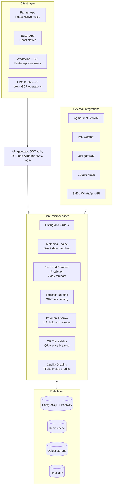
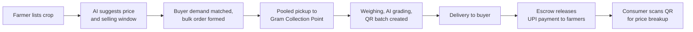

# Smart India Hackathon Workshop

**Date:** 24 November 2026
**Reference Number:** 26002443
**Name:** Chitrita G

**Problem Title:** SIH 26033: Multiple intermediaries reduce farmers' earnings and increase consumer prices.

**Problem Creator's Organization:** Ministry of Consumer Affairs, Food & Public Distribution

**Theme:** Agriculture, FoodTech & Rural Development

**Problem Description:** The expected solution is a digital marketplace that connects farmers/FPOs directly with consumers and bulk buyers, provides logistics support, and uses AI for demand forecasting and route optimization. The benefits sought are better prices for farmers, lower prices for consumers, and fewer supply chain inefficiencies.

---

## Proposed Solution

### 1. Detailed explanation of the proposed solution

AgriDirect is a mobile-first digital marketplace backed by village-level **Gram Collection Points (GCPs)** run by FPOs or Self-Help Groups. It replaces the chain of traders, agents and wholesalers with **one transparent aggregation layer** that charges a small, publicly visible service fee.

1. **Direct marketplace:** farmers and FPOs list crops and expected harvest dates; households, retailers, restaurants and bulk buyers place orders straight on the platform.
2. **AI demand and price forecasting:** live mandi prices (Agmarknet / eNAM) plus a 7-day forecast tell farmers what to grow, when to harvest and where to sell.
3. **Pooled logistics with route optimization:** orders from several farmers are combined into shared vehicle trips, cutting transport cost per kg.
4. **Instant escrow payments:** the buyer's UPI payment is held in escrow and released to the farmer within hours of verified delivery.
5. **AI quality grading:** a photo-based grade gives fair, graded pricing and fewer disputes.
6. **QR price-breakup traceability:** every crate shows its farm of origin and exactly how the consumer price is split.
7. **Voice and vernacular access:** regional languages, voice input, and WhatsApp/IVR for low-literacy and feature-phone users.

### 2. How it addresses the problem

| Cause of the problem | How AgriDirect addresses it |
| --- | --- |
| 4 to 6 intermediaries each take a margin | Direct farmer-to-buyer matching through one fixed-fee aggregation layer |
| Farmers lack price information | Live mandi prices and AI forecasts on the farmer's phone |
| Small farmers cannot afford transport | Pooled trips with optimized routes shared across farmers |
| Delayed, opaque payments and agent credit | Escrow with fast UPI settlement |
| Consumers cannot see where money goes | QR code with a price-breakup per batch |

### 3. Innovation and uniqueness of the solution

- Combines AI forecasting, pooled logistics, escrow payments and QR price transparency in one platform, rather than only a listing app.
- Built on existing FPOs and village collection points, so it strengthens local institutions instead of bypassing them.
- A visible price breakup shows consumers and the government exactly where the margin goes.
- Voice-first, vernacular access so smallholders can use it without literacy or a smartphone.

---

## Technical Approach

### 1. Technologies to be used

- **Frontend:** React Native (farmer and buyer apps), React web dashboard for FPOs, WhatsApp Business API and IVR for feature phones.
- **Backend:** FastAPI / Node.js microservices behind an API gateway; JWT, OTP and Aadhaar eKYC login.
- **Database:** PostgreSQL + PostGIS (orders, geo data), Redis (caching), object storage (images), data lake (analytics).
- **AI / ML:** Prophet or LSTM for demand and price forecasting (TensorFlow / PyTorch); MobileNet on TensorFlow Lite for quality grading.
- **Route optimization:** Google OR-Tools vehicle-routing solver; Google Maps API.
- **Payments:** UPI payment gateway with escrow and automated settlement.
- **Data sources:** Agmarknet, eNAM, IMD weather API.
- **Deployment and security:** Docker and Kubernetes on cloud; encryption in transit and at rest, role-based access, DPDP Act-aligned consent.

### 2. Methodology and process (flow chart)

**System architecture**

**Implementation flow**

**Pilot approach:** start with 3 to 5 villages and 2 perishable crops (for example tomato and banana) in one district, then scale state-wide.

---

## Feasibility and Viability

### 1. Analysis of the feasibility of the idea

- **Technical:** every component uses mature, open technology and public APIs (Agmarknet, UPI, Google Maps).
- **Operational:** builds on existing FPOs, eNAM and the PM-KISAN registry instead of creating a parallel system.
- **Financial:** a platform fee of about 3 to 5 percent of transaction value, much lower than the combined margins of multiple intermediaries; extra revenue from market analytics for institutional buyers.

### 2. Potential challenges and risks

| Challenge | Strategy to overcome it |
| --- | --- |
| Low digital literacy | Voice UI, regional languages, FPO field agents, WhatsApp/IVR fallback |
| Farmers depend on agents for credit | Fast escrow payouts; tie-ups with banks for crop-linked micro-credit |
| Quality disputes | AI grading plus photo evidence logged at the GCP |
| Cold-chain gaps for perishables | Shared cold storage partnerships; shorter pooled routes |
| Trust and adoption | Visible price breakup, pilots with trusted FPOs, farmer champions |

### 3. Strategies for overcoming these challenges

- Start small with trusted FPOs and two crops, prove the income gain, then expand.
- Keep a human layer (GCP operators and field agents) alongside the app.
- Partner with banks, cold-storage operators and logistics providers rather than building everything.

---

## Impact and Benefits

### 1. Potential impact on the target audience

- **Farmers and FPOs:** estimated 20 to 35 percent higher realization per kg, payment within hours, less distress selling.
- **Consumers and bulk buyers:** estimated 10 to 20 percent lower prices, fresher produce, traceable origin.
- **Government:** real-time supply and demand data for policy and price-stabilization planning.

### 2. Benefits of the solution (social, economic, environmental)

- **Social:** fairer incomes, rural jobs (GCP operators, drivers, graders), inclusion of small and women-led farmer groups.
- **Economic:** fewer supply chain layers and lower transaction cost; higher farm income.
- **Environmental:** pooled trips reduce vehicle kilometers and emissions; better demand matching reduces post-harvest food waste.

> The percentage figures above are planning estimates to be validated in the pilot.

---

## Research and References

### 1. Details / links of the reference and research work

- Agmarknet (mandi price data): https://agmarknet.gov.in
- eNAM, National Agriculture Market: https://enam.gov.in
- India Meteorological Department, weather data: https://mausam.imd.gov.in
- NPCI UPI documentation: https://www.npci.org.in
- Google OR-Tools, vehicle routing: https://developers.google.com/optimization/routing
- Prophet forecasting library: https://facebook.github.io/prophet
- TensorFlow Lite: https://www.tensorflow.org/lite
- Project code repository: https://github.com/selvasachein/SIH-26033.git

> Note: the farmer's-share-of-price range cited in the problem analysis is indicative; confirm it against a published study (for example NABARD, RBI or ICRIER) before final submission.

